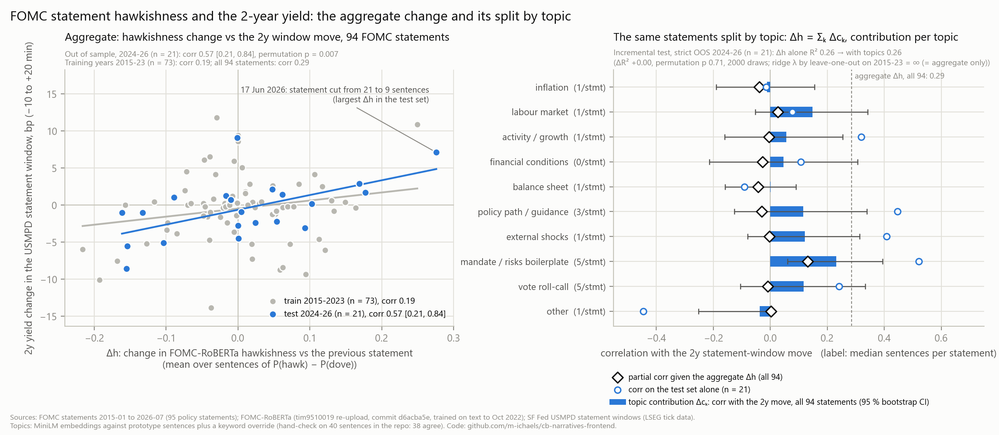

# cb-narratives-frontend

Does an FOMC statement's hawkishness move the 2-year Treasury yield, and does splitting it by topic add anything?

The overall tone does: its change moves with the 2-year yield in the 30 minutes around the release (correlation 0.57 on the 21 statements of 2024-26, 0.29 across all 94 since 2015). Splitting it by topic adds nothing detectable: a model allowed to use ten topic scores chose not to. The likely reason is that a statement gives most topics a single sentence; longer texts such as speeches may suit a split better.

## Background

Biosca and Wales (2026) use a language model to read central-bank communication and score three narratives (AI, tariffs, the Hormuz oil shock) through four lenses (inflation, labour, activity, policy). Their argument is that a score means something only beside a second score. This repository tests one version of that comparison on a text whose market reaction is measured precisely, the FOMC statement: once the aggregate hawkishness is known, do per-topic scores of the same statement carry more information about the front end? Their model and prompts are not published, so this uses an open model (FOMC-RoBERTa) and its own topic list; it does not reproduce their scores.

## Result

94 policy statements, 2015 to July 2026; fitted on 2015-23 (73), tested on 2024-26 (21). The target is the 2-year yield change from 10 minutes before to 20 minutes after the release (SF Fed USMPD).

**Aggregate.** Δh is the change in mean sentence hawkishness, P(hawk) − P(dove), against the previous policy statement.

| sample | corr(Δh, 2y) | 95 % CI | n | permutation p |
|---|---|---|---|---|
| test, 2024-26 | 0.57 | [0.21, 0.84] | 21 | 0.007 |
| training, 2015-23 | 0.19 | [−0.09, 0.44] | 73 | 0.097 |
| all | 0.29 | [0.06, 0.48] | 94 | 0.006 |

The relation is strongest in 2024-26; dropping any single test statement leaves a correlation between 0.45 and 0.69.

**Per topic.** Model A regresses the 2y move on Δh; model B adds the ten topic contributions (Δh is exactly their sum), with a ridge penalty on the topic block only, chosen by leave-one-out on the training years. Leave-one-out chose an infinite penalty, so B is A: the topic block adds ΔR² = 0.00 out of sample (permutation p = 0.715 over 2,000 shuffles; the null's 95th percentile is +0.024). Topic tone changes give the same; topic prevalence changes make the fit worse (ΔR² −0.20).

**Probable reason.** A statement is terse:

- most topics get one sentence per statement (median 1 for six of the ten and 0 for financial conditions; 3 for policy guidance, 5 for the boilerplate and the vote);
- a topic's tone change is undefined in 206 of 940 statement-topic pairs, because the topic is missing from one of the two statements;
- vote roll-call fragments are 22 % of all sentences;
- of the three narratives in Biosca and Wales, tariffs and AI never appear in the 99 statement files, and the Middle East or Hormuz appears in 9 sentences across 7 statements.

Caveats: 21 test statements; the topic list is this repository's, not theirs; the topic assignment was hand-checked on 40 sentences (38 agree). Full results are in [results/topic_tests.md](results/topic_tests.md); definitions and every test are in [docs/method.md](docs/method.md).



## Layout

| path | contents |
|---|---|
| `scripts/topic_split.py` | scores every sentence with FOMC-RoBERTa, assigns topics, aggregates per statement and topic |
| `scripts/analysis.py` | the tests, written to `results/topic_tests.md` and `.json` |
| `scripts/handcheck.py`, `scripts/figure.py`, `scripts/test_analysis.py` | the hand check, the chart, unit tests |
| `scripts/common.py` | paths, the sentence split and scoring shared with rates-curve-nlp, the topic list |
| `data/` | sentence scores and topics, per-statement and per-topic tables, the hand-check sample |

## Reproduce

The FOMC statements, the USMPD file and the statement-level features come from [rates-curve-nlp](https://github.com/m-ichaels/rates-curve-nlp), cloned next to this repository (or set `RCN_DIR`).

```bash
git clone https://github.com/m-ichaels/rates-curve-nlp ../rates-curve-nlp
(cd ../rates-curve-nlp && python tools/download.py data/raw)
pip install numpy pandas matplotlib openpyxl torch transformers sentence-transformers pytest
huggingface-cli download tim9510019/FOMC-RoBERTa --revision d6acba5e8c62eb35f79527a099af789cd778387d
huggingface-cli download sentence-transformers/all-MiniLM-L6-v2 --revision 1110a243fdf4706b3f48f1d95db1a4f5529b4d41
python scripts/topic_split.py      # about 25 minutes on CPU; sentence scores cached in data/cache/
python scripts/handcheck.py --score
python scripts/analysis.py
python scripts/figure.py
python -m pytest scripts/test_analysis.py
```

`data/` already holds the scored sentences, so `analysis.py` and `figure.py` run without the models; `analysis.py` still reads the rates-curve-nlp checkout.

## References

- Biosca, P. and Wales, D. (2026), *Tracking Central Bank Narratives with LLMs*, Fulcrum Asset Management, 28 July.
- Shah, A., Paturi, S. and Chava, S. (2023), *Trillion Dollar Words*, arXiv:2305.07972 (FOMC-RoBERTa).
- Acosta, M., Ajello, A., Bauer, M., Loria, F. and Miranda-Agrippino, S. (2025), *Financial Market Effects of FOMC Communication: Evidence from a New Event-Study Database*, FRBSF Working Paper 2025-30 (USMPD).
- Reimers, N. and Gurevych, I. (2019), *Sentence-BERT*, EMNLP (the MiniLM embeddings).
